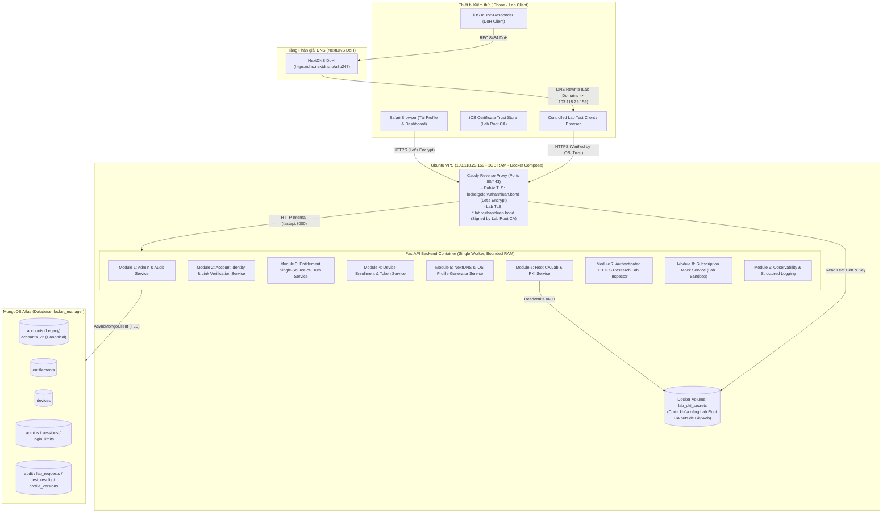

# ARCHITECTURE DESIGN — LOCKET GOLD RESEARCH & ENTITLEMENT LAB

**Phiên bản thiết kế:** 2.0.0  
**Mục tiêu:** Kiến trúc hệ thống quản trị tài khoản, thiết bị, chứng chỉ Root CA Lab, cấu hình iOS DoH (`.mobileconfig`) và mô phỏng giao thức thuê bao (Subscription Entitlement Protocol) trong môi trường kiểm thử được kiểm soát.

---

## 1. TỔNG QUAN KIẾN TRÚC HỆ THỐNG (SYSTEM TOPOLOGY)

Hệ thống được thiết kế cho VPS Ubuntu ~1 GB RAM (`103.118.29.159`), tên miền `locketgold.vuthanhluan.bond`, kết nối tới cơ sở dữ liệu MongoDB Atlas (`locket_manager`) và tích hợp cấu hình NextDNS (`a8b247`).



---

## 2. THIẾT KẾ CHI TIẾT 10 MODULE ĐỘC LẬP

### Module 1 — Admin Service (`app/services/admin_service.py`, `app/routers/admin.py`)
- **Trách nhiệm:**
  - Xác thực Superadmin bằng `PBKDF2-HMAC-SHA256` (600,000 vòng) kết hợp Cloudflare Turnstile (tùy chọn) và Rate Limiting hai tầng (In-Memory + MongoDB `login_limits`).
  - Quản lý phiên đăng nhập (`sessions`) lưu mã băm SHA-256 của Bearer token (48 bytes URL-safe), hỗ trợ thu hồi phiên tức thì (`logout` hoặc đổi `auth_version`).
  - Ghi nhật ký kiểm toán (`audit` collection) cho mọi thao tác quản trị: đăng nhập, thêm tài khoản, xác minh UUID, cấp/thu hồi entitlement, liên kết/thu hồi thiết bị, sinh chứng chỉ CA hoặc xuất `.mobileconfig`.

### Module 2 — Account Identity Service (`app/services/identity_service.py`)
- **Trách nhiệm:**
  - Tiếp nhận đầu vào từ Admin:
    1. **Link chia sẻ:** Ví dụ `https://locket.cam/<username>` hoặc `@<username>`.
    2. **Định danh trực tiếp (UID / UUID):** Ví dụ chuỗi UID 28 ký tự hoặc `account_id` nội bộ.
  - **Quy tắc xác minh minh bạch (Zero-Guessing Policy):**
    - Kiểm tra cú pháp URL/handle nghiêm ngặt.
    - Nếu đầu vào chỉ là `username` hoặc link `https://locket.cam/<username>`, dịch vụ kiểm tra xem trang công khai hoặc provider hợp pháp được cấu hình có trả về `uid` xác thực được hay không.
    - **Tuyệt đối không tự suy đoán hoặc giả định `username == uid` nếu chưa xác minh.** Hệ thống lưu rõ trạng thái xác minh (`verification_status`: `verified_uid`, `unverified_handle`, `manual_lab_id`) và `verification_method` (`direct_uid`, `public_meta_resolved`, `admin_manual_override`). Nếu một link không cung cấp được UUID/UID có thể xác minh, API trả về cảnh báo rõ ràng cho Admin để Admin quyết định nhập UID trực tiếp hoặc đánh dấu là tài khoản thử nghiệm (`manual_lab_id`).

### Module 3 — Entitlement Service (`app/services/entitlement_service.py`)
- **Trách nhiệm:** Là **Nguồn dữ liệu duy nhất (Single Source of Truth - SSOT)** quyết định trạng thái thuê bao trong toàn hệ thống.
- **Máy trạng thái (State Machine) rõ ràng:**
  - `active` yêu cầu cả tài khoản và bản ghi Gold đúng Firebase UID đã xác minh có trạng thái active, chưa bị thu hồi và còn hạn UTC. Mốc hết hạn hiệu lực là mốc sớm hơn của hai bản ghi. UID trích từ invite token công khai 44 ký tự được lưu cùng nguồn và ở trạng thái `unverified_uid` cho đến khi có bằng chứng độc lập.
  - `expired`: Tài khoản tồn tại, không bị thu hồi, nhưng `expires_date <= now_utc`.
  - `revoked`: Tài khoản bị Admin chủ động thu hồi quyền (`status == "revoked"` hoặc `revoked_at is not None`), bất kể `expires_date` còn hạn hay không.
  - `pending`: Tài khoản mới thêm vào hệ thống để chờ xác minh thiết bị/UUID, chưa kích hoạt quyền (`status == "pending"`).
  - `unauthorized`: Tài khoản **không tồn tại** trong cơ sở dữ liệu hoặc thiết bị gọi API không hợp lệ.
- **Chốt chặn an toàn (Fail-Closed):**
  - Xóa bỏ hoàn toàn đoạn code `if expiry is None: expiry = datetime(2029, 12, 31, ...)` từng gây lỗi ở bản cũ.
  - Khi tài khoản ở trạng thái `expired`, `revoked`, `pending` hoặc `unauthorized`, `Entitlement Service` luôn trả về `is_active = False` và `entitlements = {}`.

### Module 4 — Device Service (`app/services/device_service.py`)
- **Trách nhiệm:**
  - Quản lý liên kết giữa Tài khoản (`account_id`) và Thiết bị kiểm thử (`device_id`, `udid_hash`, `device_name`, `ios_version`).
  - Cấp phát **Enrollment / Device Token** riêng biệt cho từng thiết bị (lưu hash SHA-256 trong collection `devices`), giới hạn số lượng thiết bị tối đa trên mỗi tài khoản (`max_devices`, mặc định `1` hoặc `2`).
  - Hỗ trợ thu hồi từng thiết bị (`revoke_device`): Khi thiết bị bị thu hồi, profile hoặc request kiểm thử kèm `device_token` đó sẽ bị từ chối ngay lập tức mà không ảnh hưởng tới thiết bị hợp lệ khác.

### Module 5 — NextDNS Profile Service (`app/services/profile_service.py`)
- **Trách nhiệm:**
  - Sinh tệp cấu hình iOS `.mobileconfig` chuẩn XML Plist (`application/x-apple-aspen-config`) với `PayloadUUID` v4 duy nhất và lưu lịch sử vào collection `profile_versions`.
  - Hỗ trợ 3 chế độ cấu hình rõ ràng cho Research Lab:
    1. **Mode `dns_only`:** Chỉ cài đặt `com.apple.dnsSettings.managed` trỏ về `https://dns.nextdns.io/a8b247`.
    2. **Mode `dns_and_lab_ca`:** Kết hợp `com.apple.dnsSettings.managed` (`https://dns.nextdns.io/a8b247`) và `com.apple.security.root` (nhúng chứng chỉ Root CA của Research Lab đang còn hiệu lực).
    3. **Mode `scoped_lab_doh`:** Cho phép cấu hình `SupplementalMatchDomains` chỉ định rõ danh sách các tên miền thử nghiệm trong Lab (`*.lab.vuthanhluan.bond`, `sub-mock.vuthanhluan.bond`) để kiểm thử hành vi Split-DNS của iOS mà không ảnh hưởng đến lưu lượng Internet thông thường của iPhone.
  - Cung cấp công cụ kiểm tra chéo (Verification Helper) hướng dẫn kiểm tra `https://test.nextdns.io` và định danh thiết bị trên NextDNS Logs (ví dụ qua Device Name prefix trong DoH URL `https://dns.nextdns.io/a8b247/<device-label>`).

### Module 6 — Root CA Lab Service (`app/services/pki_service.py`)
- **Trách nhiệm:**
  - Giải quyết triệt để lỗi chứng chỉ của hệ thống cũ (nơi chứng chỉ `LocketProxy CA` có `NotBefore = 26/09/2026`, thiếu `KeyUsage`, và không có Private Key).
  - Tự động khởi tạo hoặc nạp **Lab Root CA** chuẩn RFC 5280 & Apple HT210176:
    - `NotBefore`: `now_utc - 7 days` (đảm bảo luôn hợp lệ ngay lập tức trên mọi iPhone có đồng hồ chuẩn).
    - `NotAfter`: `now_utc + 3650 days` (10 năm cho Root CA).
    - `BasicConstraints(ca=True, path_length=0)` (`critical=True`).
    - `KeyUsage(digital_signature=True, key_cert_sign=True, crl_sign=True)` (`critical=True`).
    - `SubjectKeyIdentifier` & `AuthorityKeyIdentifier`.
  - Cấp phát **Server Leaf Certificate** cho các tên miền thuộc phạm vi Lab do bạn sở hữu (ví dụ `locketgold.vuthanhluan.bond`, `mock.lab.vuthanhluan.bond`):
    - Thời hạn $\le 397$ ngày (tuân thủ giới hạn 398 ngày của Apple iOS).
    - Có đầy đủ `SubjectAlternativeName (SAN)` và `ExtendedKeyUsage(serverAuth)`.
  - **Bảo mật khóa riêng:** Private Key của Root CA chỉ được lưu trên volume bảo mật (`chmod 0600`) bên ngoài thư mục web và bị chặn tuyệt đối trong `.gitignore` / `.dockerignore`. Không bao giờ xuất Private Key qua bất kỳ API hay file `.mobileconfig` nào.

### Module 7 — HTTPS Research Proxy / Inspector (`app/routers/lab_inspector.py`)
- **Trách nhiệm:**
  - Thay thế module `/proxy` (`app/locket_modifier.py`) cũ vốn có nguy cơ trở thành Open Proxy hoặc rò rỉ token.
  - Chỉ hoạt động như một **Authenticated Lab Traffic Inspector & Echo Sandbox**:
    - Yêu cầu xác thực bằng `Device Token` hoặc `Lab Session Token`.
    - Ghi nhận chi tiết headers, TLS SNI, client IP, request ID, payload schema và độ trễ vào collection `lab_requests` (tự động che mờ/mask các header nhạy cảm như `Authorization`, `Cookie`).
    - Tuyệt đối không chuyển tiếp (forward) trái phép lưu lượng hay thông tin đăng nhập tới máy chủ bên thứ ba ngoài danh sách sandbox được phép.

### Module 8 — Subscription Mock Service (`app/services/subscription_mock_service.py`, `app/routers/subscribers.py`)
- **Trách nhiệm:**
  - Cung cấp endpoint mô phỏng giao thức kiểm tra thuê bao tương thích cấu trúc `CustomerInfo`:
    - `GET /v1/subscribers/{account_id}`
    - `GET /api/lab/subscribers/{account_id}`
  - **Cơ chế xác thực linh hoạt cho Lab Client:**
    - Chấp nhận `Authorization: Bearer <SUBSCRIBER_API_TOKEN>`, hoặc `<ADMIN_SESSION_TOKEN>`, hoặc `<DEVICE_ENROLLMENT_TOKEN>` (hoặc Public API Key dành riêng cho Lab Client `rc_lab_pub_*` được cấp phát trong Admin Dashboard). Nhờ đó, ứng dụng thử nghiệm trên iPhone có thể gọi API mà không cần nhúng token của Superadmin!
  - **Phản hồi trung thực theo Database (`Entitlement Service`):**
    - Nếu tài khoản `active`: Trả về JSON có `entitlements.Gold` với đúng `expires_date`, `purchase_date` và `product_identifier` lấy từ MongoDB `accounts_v2` / `entitlements`.
    - Nếu tài khoản `expired`, `revoked`, `pending` hoặc `unauthorized` (không tồn tại): Trả về `entitlements: {}`, `subscriptions: {}` kèm header `X-Lab-Entitlement-Status: <status>` để kỹ sư kiểm thử quan sát rõ nguyên nhân trên iPhone.

### Module 9 — Observability (`app/services/observability_service.py`)
- **Trách nhiệm:**
  - Gắn `X-Request-ID` (UUIDv4) và đo thời gian xử lý (`X-Process-Time-Ms`) cho mọi HTTP request.
  - Cung cấp endpoint `/api/health` (kiểm tra trạng thái kết nối MongoDB, trạng thái nạp Root CA, trạng thái cấu hình NextDNS) cho Docker Healthcheck và Admin Dashboard.
  - Lưu trữ kết quả các kịch bản kiểm thử (`test_results`) và thống kê tổng quan (số tài khoản active/expired/revoked, số thiết bị đã liên kết, số lượt tải profile, nhật ký kiểm thử gần nhất).

### Module 10 — Deployment (`Dockerfile`, `compose.yaml`, `Caddyfile`)
- **Trách nhiệm:**
  - Đóng gói toàn bộ hệ thống chạy ổn định trên VPS Ubuntu ~1 GB RAM.
  - Sử dụng Caddy làm Reverse Proxy tự động cấp chứng chỉ TLS cho `locketgold.vuthanhluan.bond` và định tuyến về container FastAPI.

---

## 3. THIẾT KẾ CƠ SỞ DỮ LIỆU MONGODB (`locket_manager`) & CHIẾN LƯỢC MIGRATION

### 3.1. Nguyên tắc Bảo toàn Dữ liệu (Zero-Data-Loss Migration)

- **Giữ nguyên tên database:** `locket_manager`.
- **Không xóa hoặc làm hỏng collection `accounts` cũ:**
  - Collection `accounts` hiện tại được giữ nguyên và đồng bộ hai chiều (dual-write / fallback-read) trong giai đoạn chuyển đổi.
  - Tạo collection chuẩn hóa `accounts_v2` với `schema_version: 2` để lưu đầy đủ trạng thái, lịch sử xác minh, liên kết thiết bị và thông tin thu hồi.
  - Script migration (`scripts/migrate_db.py`) chạy idempotent: đọc toàn bộ bản ghi từ `accounts`, chuẩn hóa mọi biến thể trường thời gian (`expires_date`, `expires_at`, `gold_expires_at`), gán `status = "active"` nếu `expires_date > now` hoặc `"expired"` nếu `expires_date <= now`, và upsert sang `accounts_v2` mà không làm mất bất kỳ bản ghi nào.

### 3.2. Schema Chi tiết của 9 Collections trong `locket_manager`

#### 1. `accounts` (Legacy Collection — Giữ tương thích ngược)
```json
{
  "_id": "ObjectId(...)",
  "locket_id": "user_uid_or_id",
  "expires_date": "2027-12-31T23:59:59Z"
}
```
- **Index:** `{"locket_id": 1}` (`unique: true`).

#### 2. `accounts_v2` (Canonical Account & Identity Collection)
```json
{
  "_id": "ObjectId(...)",
  "schema_version": 2,
  "account_id": "4Vee1rBLoJN9TDjql9xPzDEuf5D2",
  "locket_id": "4Vee1rBLoJN9TDjql9xPzDEuf5D2",
  "username": "luongcamnhung",
  "source_link": "https://locket.cam/luongcamnhung",
  "verification_status": "verified_uid",
  "verification_method": "direct_uid",
  "status": "active",
  "product_identifier": "com.locket.gold.yearly",
  "purchase_date": "2026-11-24T00:00:00Z",
  "expires_date": "2027-11-24T23:59:59Z",
  "revoked_at": null,
  "revoke_reason": null,
  "max_devices": 2,
  "notes": "Tài khoản kiểm thử Lab #1",
  "created_at": "2026-11-24T14:00:00Z",
  "updated_at": "2026-11-24T14:00:00Z",
  "updated_by": "admin@example.com"
}
```
- **Indexes:**
  - `{"account_id": 1}` (`unique: true`)
  - `{"locket_id": 1}` (`unique: true`)
  - `{"username": 1}` (`sparse: true`)
  - `{"status": 1, "expires_date": 1}`

#### 3. `entitlements` (Lịch sử và Trạng thái Quyền Thuê bao)
```json
{
  "_id": "ObjectId(...)",
  "account_id": "4Vee1rBLoJN9TDjql9xPzDEuf5D2",
  "entitlement_key": "Gold",
  "product_identifier": "com.locket.gold.yearly",
  "status": "active",
  "purchase_date": "2026-11-24T00:00:00Z",
  "expires_date": "2027-11-24T23:59:59Z",
  "grace_period_expires_date": null,
  "revoked_at": null,
  "updated_at": "2026-11-24T14:00:00Z"
}
```
- **Index:** `{"account_id": 1, "entitlement_key": 1}` (`unique: true`).

#### 4. `devices` (Quản lý Thiết bị & Token Liên kết)
```json
{
  "_id": "ObjectId(...)",
  "device_id": "dev_9f8a7b6c5d4e",
  "account_id": "4Vee1rBLoJN9TDjql9xPzDEuf5D2",
  "device_name": "iPhone 15 Pro - Lab Test",
  "ios_version": "18.1",
  "token_hash": "sha256_hex_of_device_token",
  "token_prefix": "lkg_dev_9f8a",
  "status": "active",
  "last_seen_at": "2026-11-24T14:05:00Z",
  "created_at": "2026-11-24T14:00:00Z",
  "revoked_at": null
}
```
- **Indexes:**
  - `{"device_id": 1}` (`unique: true`)
  - `{"token_hash": 1}` (`unique: true`)
  - `{"account_id": 1, "status": 1}`

#### 5. `sessions` (Phiên đăng nhập Admin)
- Lưu `_id = sha256(access_token)`, `admin_id`, `auth_version`, `expires_at`.
- **Index:** `{"expires_at": 1}` (`expireAfterSeconds: 0` — TTL tự động dọn dẹp).

#### 6. `audit` (Nhật ký Thao tác Quản trị)
```json
{
  "_id": "ObjectId(...)",
  "timestamp": "2026-11-24T14:10:00Z",
  "actor": "admin@example.com",
  "action": "ENTITLEMENT_REVOKE",
  "target_id": "4Vee1rBLoJN9TDjql9xPzDEuf5D2",
  "ip_hash": "sha256_of_client_ip",
  "details": {"previous_status": "active", "new_status": "revoked", "reason": "Kiểm thử thu hồi quyền"}
}
```
- **Index:** `{"timestamp": -1}`, `{"target_id": 1, "timestamp": -1}`.

#### 7. `lab_requests` (Nhật ký Quan sát Request/Response trong Lab)
```json
{
  "_id": "ObjectId(...)",
  "request_id": "550e8400-e29b-41d4-a716-446655440000",
  "timestamp": "2026-11-24T14:12:00Z",
  "endpoint": "/v1/subscribers/4Vee1rBLoJN9TDjql9xPzDEuf5D2",
  "method": "GET",
  "account_id": "4Vee1rBLoJN9TDjql9xPzDEuf5D2",
  "device_id": "dev_9f8a7b6c5d4e",
  "computed_status": "active",
  "http_status": 200,
  "latency_ms": 4.2,
  "user_agent": "LocketLabClient/2.0 iOS/18.1"
}
```
- **Index:** `{"timestamp": -1}`, TTL 7 ngày (`expireAfterSeconds: 604800`) để bảo vệ dung lượng MongoDB Atlas Free Tier (512 MB).

#### 8. `test_results` (Kết quả Kiểm thử Tự động & Thực nghiệm iPhone)
- Lưu kết quả chạy kịch bản kiểm thử DNS, TLS, Entitlement State Machine và ghi chú quan sát thực tế trên iPhone.

#### 9. `profile_versions` (Lịch sử Cấp phát Cấu hình `.mobileconfig`)
- Lưu `profile_uuid`, `mode` (`dns_only`, `dns_and_lab_ca`, `scoped_lab_doh`), `nextdns_id`, `ca_fingerprint_sha256`, `account_id`, `device_id`, `created_at`.

---

## 4. HỢP ĐỒNG API (API CONTRACTS)

| Nhóm | Method | Endpoint | Xác thực | Mô tả |
|---|---|---|---|---|
| **Public / Web** | `GET` | `/` | Public | Trang tải cấu hình Lab & kiểm tra kết nối DNS/TLS cho iPhone |
| **Public / Web** | `GET` | `/admin` (hoặc `ADMIN_PATH`) | Public | Giao diện Admin Dashboard SPA (CSP Nonce) |
| **Health** | `GET` | `/api/health` | Public | Trạng thái hệ thống, DB ping, NextDNS ID, CA validity |
| **Auth** | `POST` | `/api/admin/login` | Public (Rate limited) | Đăng nhập bằng Email + Password (+ Turnstile) |
| **Auth** | `GET` | `/api/admin/me` | Admin Bearer | Lấy thông tin phiên Admin hiện tại |
| **Auth** | `POST` | `/api/admin/logout` | Admin Bearer | Thu hồi phiên đăng nhập hiện tại |
| **Identity** | `POST` | `/admin/verify-link` | Admin Bearer | Phân tích link `locket.cam/...` hoặc định danh, trả về trạng thái xác minh UUID |
| **Accounts** | `POST` | `/admin/add-account` | Admin Bearer | Thêm hoặc gia hạn tài khoản (đồng bộ cả `accounts` và `accounts_v2`) |
| **Accounts** | `GET` | `/admin/accounts` | Admin Bearer | Danh sách tài khoản kèm trạng thái thực (`active`, `expired`, `revoked`, `pending`) |
| **Accounts** | `POST` | `/admin/accounts/{account_id}/revoke` | Admin Bearer | Thu hồi quyền entitlement ngay lập tức (không xóa mất lịch sử) |
| **Accounts** | `POST` | `/admin/accounts/{account_id}/activate` | Admin Bearer | Kích hoạt lại tài khoản và cập nhật `expires_date` |
| **Accounts** | `DELETE` | `/admin/accounts/{account_id}` | Admin Bearer | Xóa hoàn toàn tài khoản khỏi DB |
| **Devices** | `POST` | `/admin/devices` | Admin Bearer | Liên kết thiết bị iPhone vào tài khoản và sinh `device_token` |
| **Devices** | `GET` | `/admin/devices` | Admin Bearer | Danh sách thiết bị đã liên kết |
| **Devices** | `POST` | `/admin/devices/{device_id}/revoke` | Admin Bearer | Thu hồi quyền truy cập của thiết bị |
| **Profiles** | `GET` | `/profile.mobileconfig` | Public / Token | Tải cấu hình `.mobileconfig` (hỗ trợ query `?mode=dns_only\|dns_and_lab_ca\|scoped_lab_doh&device_token=...`) |
| **PKI Lab** | `GET` | `/api/lab/ca.cer` | Public | Tải chứng chỉ công khai Root CA của Research Lab (DER/PEM) |
| **PKI Lab** | `GET` | `/admin/pki/status` | Admin Bearer | Xem thông số X.509, SHA-256 fingerprint, hạn dùng của Lab Root CA |
| **Entitlement** | `GET` | `/v1/subscribers/{account_id}` | Subscriber / Device / Admin Token | API mô phỏng `CustomerInfo` dựa trên dữ liệu thật trong MongoDB |
| **Observability** | `GET` | `/admin/logs` | Admin Bearer | Xem `audit`, `lab_requests` và thống kê kết quả kiểm thử |
| **Observability** | `POST` | `/admin/test-results` | Admin Bearer | Lưu kết quả kiểm thử thực tế từ iPhone / Lab Client |

---

## 5. THIẾT KẾ TRIỂN KHAI VPS UBUNTU (~1 GB RAM) VỚI DOCKER COMPOSE & CADDY

Với VPS có dung lượng RAM khoảng **1 GB (1024 MB)** và sử dụng **MongoDB Atlas** (cloud database), chúng ta **không chạy container `mongo:8.0` trên VPS** (vì riêng MongoDB 8.0 chiếm 400–600 MB RAM sẽ gây OOM Kill). Toàn bộ VPS chỉ chạy 2 container siêu nhẹ:

1. **`caddy` (Caddy 2 Alpine):** Chiếm ~25–40 MB RAM (`mem_limit: 128m`).
   - Tự động xin và gia hạn chứng chỉ Let's Encrypt cho `locketgold.vuthanhluan.bond`.
   - Chấm dứt TLS (TLS Termination), nén Zstd/Gzip, giới hạn kích thước request, và reverse proxy tới `api:8000`.
   - Cấu hình healthcheck và trả trang lỗi tĩnh thân thiện nếu container `api` đang khởi động lại.
2. **`api` (FastAPI Python 3.12 Slim):** Chiếm ~70–110 MB RAM (`mem_limit: 384m`).
   - Chạy 1 Uvicorn worker với `--no-access-log` (nhật ký đã được quản lý có cấu trúc qua Observability Service và giới hạn kích thước log file Docker `max-size: 10m`, `max-file: 3`).
   - **Graceful Degradation khi khởi động:** Nếu `ROOT_CA_PATH` chưa có hoặc MongoDB Atlas tạm thời chập chờn lúc boot, Uvicorn vẫn khởi động thành công để phục vụ `/api/health` (báo rõ mã lỗi `DB_DISCONNECTED` hoặc `CA_NOT_CONFIGURED`) và tự động kết nối lại ở các request tiếp theo, tuyệt đối không làm sập container khiến Caddy bị lỗi `502 Bad Gateway`.
